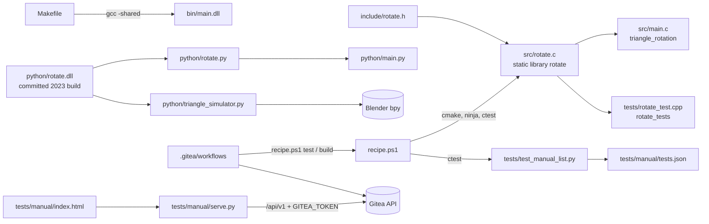

# triangle-rotation: documentation hub

A C library (`include/rotate.h`, `src/rotate.c`) that rotates points, `struct Vector` values and `struct Triangle` values in 3D around the X, Y and Z axes and towards a direction given by two angles, places an equilateral triangle of a given side around the origin, and reports the z of its vertices. Around it sit a console demo (`src/main.c`), GoogleTest cases, a Python `ctypes` wrapper over a committed DLL, a Blender script, and the build, test and release tooling of the owner's "lab" (Gitea workflows, git hooks, a manual-test page). Who uses the library outside this repository is not stated in the code (see [Open questions](../SPEC.md#9-open-questions)).

## Status

- Branch: `tr-59/docs/spec-md`, the head of the open GitHub pull request #2 into `test`. Last commit: `a52fce0`, 2026-11-17 21:19 +02:00, "docs(spec): add SPEC.md mirrored as Jira KAN-59" (`git log -1`); its parent `aa49d43` (2026-11-08 03:36 +02:00, `lab-bot`, "docs(docs): changelog for v1.0.0") is the tip of `test`. 19 commits in this branch's history; the first is from 2023-08-17.
- Release: tag `v1.0.0` points to `5062236`, 2026-11-08 03:33 +02:00, the merge of pull request #24 from `test` into `release` (`git tag -l`, `git rev-parse v1.0.0`). That merge is not in this branch's history, but the code is the same: `git diff --stat 5062236 a52fce0` lists only `CHANGELOG.md` and `SPEC.md`.
- Tests: 14 GoogleTest cases in `tests/rotate_test.cpp` and 2 pytest tests in `tests/test_manual_list.py`, both registered with CTest (`CMakeLists.txt:53-59`). The manual test list `tests/manual/tests.json` is empty.
- CI: five Gitea Actions workflows in `.gitea/workflows/` (`propose`, `test`, `release-gate`, `release`, `sweep`), all `runs-on: windows`. There is no `.github/workflows/`, so the public GitHub copy runs no CI (inference: GitHub Actions reads only `.github/workflows/`).
- TODO/FIXME: none in the project code. `tools/wiki.py` contains the word "todo" on 22 lines (27 occurrences, any case), all as the tag vocabulary it parses, not as open work.
- Evidently unfinished:
  - the README lists nine exceptions to the lab requirements, R-02, R-09, R-12, R-13 (twice), R-14, R-37, R-41, R-42, tracked as issues #8 to #16 (`README.md:32`); what those requirements say, and whether those issues are still open, is not in this repository;
  - the Python wrapper and the Blender script have defects found while writing this document (see [Known limitations](#known-limitations-and-problems));
  - six open tasks are listed in [SPEC.md 3.9](../SPEC.md#39-declared-but-not-implemented), whose task list mirrors Jira ticket KAN-59; four of them were proposed on 2026-11-17 in the first version of `SPEC.md` on this branch, which this version replaces, and are already checkboxes there.

## Layout

| Path | What it is |
|---|---|
| `include/rotate.h` | The C API: `struct Vector`, `struct Triangle`, 14 functions, `extern "C"` guard |
| `src/rotate.c` | The rotations, the triangle constructor and `get_heights` |
| `src/main.c` | Demo `triangle_rotation`: triangle of side 3, turned by `(90, 90)`, printed with its heights |
| `tests/rotate_test.cpp` | GoogleTest cases for every function in `rotate.h` |
| `tests/test_manual_list.py` | pytest checks of the format of `tests/manual/tests.json` |
| `tests/manual/` | Manual-test page (`index.html`), its local proxy (`serve.py`) and the list (`tests.json`) |
| `python/rotate.py`, `python/main.py` | `ctypes` wrapper over `python/rotate.dll`, and a demo that uses it |
| `python/triangle_simulator.py` | Blender script: turns a triangle and tries to add it as a mesh |
| `python/rotate.dll`, `bin/main.exe` | Binaries committed in 2023, built from older source (see limitations) |
| `CMakeLists.txt` | CMake build: static library `rotate`, demo, tests, GoogleTest 1.13.0 |
| `Makefile` | Earlier build route: `gcc -shared` of `src/*.c` into `bin/main.dll` |
| `recipe.ps1` | PowerShell entry point: `build`, `test`, `run`, `clean`, `publish`, `info`, `install`, `uninstall` |
| `tools/wiki.py` | Wiki generator vendored from another lab repository |
| `.gitea/` | CI workflows, issue and pull request templates |
| `.claude/` | Claude Code settings, hooks (`gate.ps1`, logging), git hooks, skill `lab-ai-env` |
| `.clang-format`, `.clang-tidy` | Formatting and static-analysis rules applied by `recipe.ps1 test` |
| `.vscode/` | VS Code tasks and launch configuration for the `make` route |
| `docs/install.md`, `docs/manual.md` | Install and usage notes; `tools/wiki.py` copies them to the wiki |
| `SPEC.md` | Requirements specification; its task list mirrors Jira ticket KAN-59 |
| `CHANGELOG.md` | Release notes of v1.0.0 (2026-11-08), written onto `test` by the `release` workflow (`.gitea/workflows/release.yaml:402-418`) |
| `CLAUDE.md`, `CONTRIBUTING.md`, `LICENSE` | Repository rules, contribution steps, MIT licence |

## Architecture

The library is stateless C: every function reads and writes only through its arguments, and the file-scope values in `src/rotate.c:6-10` are `static const`. The axis rotations are the base; the vector, triangle and direction functions are compositions of them (`src/rotate.c:50-91`). The library talks to no hardware and no network.

Two consumers are built from the current source by CMake: the demo and the tests. The Python side does not use a build of the current source: it loads `python/rotate.dll`, committed on 2023-09-08 (`git log -- python/rotate.dll`), and no build rule in the repository produces that file.

The lab tooling talks to a Gitea server: the workflows call its API with the secret `LAB_BOT_TOKEN`, and `tests/manual/serve.py` forwards the manual-test page's API calls to the server named by the `origin` remote, adding `GITEA_TOKEN`.

## Build and run

Prerequisites, each with its source:

| Tool | Version | Source |
|---|---|---|
| mingw gcc and g++ | 13 or newer | `docs/install.md:7`; selected by name in `recipe.ps1:53` |
| CMake | 3.28 or newer | `CMakeLists.txt:1` |
| Ninja | not pinned | `recipe.ps1:53` (`-G Ninja`) |
| LLVM `clang-tidy`, `clang-format` | not pinned | `recipe.ps1:120`, `recipe.ps1:123` |
| Python with pytest | not pinned | `CMakeLists.txt:57` (CTest test `manual_list`) |
| Windows PowerShell | 5.1 (inference: the PR template asks that new PowerShell "parses in 5.1") | `.gitea/pull_request_template.md:16` |
| Network on first configure | GoogleTest v1.13.0 archive, SHA256-pinned | `CMakeLists.txt:39-44` |

`recipe.ps1` prepends `C:\Program Files\LLVM\bin` and `C:\ProgramData\mingw64\mingw64\bin` to its own PATH when those folders exist (`recipe.ps1:47-49`).

Commands:

| Command | Effect | Source |
|---|---|---|
| `.\recipe.ps1 build` | CMake configure (Ninja, gcc/g++, Release) into `build\` and build | `recipe.ps1:51-57`, `74-77` |
| `.\recipe.ps1 test` | Set git hooks path, build, `ctest`, `clang-tidy`, `clang-format -i`, lock and exception search | `recipe.ps1:111-128` |
| `.\recipe.ps1 run [args]` | Build, then run `build\triangle_rotation.exe` with the args | `recipe.ps1:86-91` |
| `.\recipe.ps1 clean` | Remove `dist`, `build`, `out` | `recipe.ps1:80-85` |
| `.\recipe.ps1 info` | Print name, code, version, summary, provided folders | `recipe.ps1:103-110` |
| `.\recipe.ps1 publish` | Copy `include` and `src` to `$env:LAB_SHARE\needs\triangle-rotation\v1.0.0` | `recipe.ps1:92-102` |
| `.\recipe.ps1 install` / `uninstall` | Print "nothing to install" / "nothing to uninstall" | `recipe.ps1:78-79` |
| `make` | Build `bin/main.dll` from `src/*.c` with `gcc -shared` | `Makefile:10`, `Makefile:18-19` |
| `make run` | `make clean` (`rm bin/*`), build, then execute `./bin/main.dll` | `Makefile:15-16`, `21-22` |

Without the recipe: put `include` on the include path, compile `src/rotate.c` as C11 and link `-lm` (`docs/install.md:3`).

## Configuration

| Name | Kind | Meaning | Default | Source |
|---|---|---|---|---|
| `BUILD_TESTING` | CMake option | Build `rotate_tests` and register both CTest tests | `ON` | `CMakeLists.txt:14` |
| `LAB_SHARE` | env var | Destination root for `recipe.ps1 publish`; the verb exits 1 without it | unset | `recipe.ps1:94-95` |
| `.claude/.env` | file, gitignored | `KEY=VALUE` lines loaded by `recipe.ps1` into the environment when the variable is not already set | absent | `recipe.ps1:36-44`, `.gitignore:24` |
| `GITEA_TOKEN` | env var or `.claude/.env` | Key `serve.py` adds to forwarded API calls; the environment wins | none, `serve.py` exits | `tests/manual/serve.py:52-62` |
| `LAB_BOT_TOKEN`, `TOKEN` | env var | Key for `tools/wiki.py --push` when `--token` is not given | none | `tools/wiki.py:400` |
| `secrets.LAB_BOT_TOKEN` | CI secret | Key every workflow uses for the Gitea API | none | `.gitea/workflows/*.yaml` |
| `$Name`, `$Code`, `$Version`, `$Summary`, `$Provides` | recipe literals | Project identity read as text by hooks and workflows | `triangle-rotation`, `tr`, `1.0.0`, `include`+`src` | `recipe.ps1:11-20` |
| `$CommitTypes`, `$CommitScopes`, `$BranchTypes`, `$Reviewers`, `$OverridePhrase` | recipe literals | Commit and branch vocabulary, reviewers, owner-override marker (value not repeated here) | see file | `recipe.ps1:22-26` |
| `tools/wiki.py` flags | CLI | `--push`, `--wiki-url`, `--token`, `--sha`, `--out` | dry run | `tools/wiki.py:380-384` |
| `.clang-format` | file | LLVM base style, 120 columns, 4-space indent | - | `.clang-format` |
| `.clang-tidy` | file | `clang-diagnostic-*`, `clang-analyzer-*`, `bugprone-*`, `performance-*`, `portability-*`, all as errors, target `x86_64-w64-mingw32` | - | `.clang-tidy` |
| `.claude/settings.json` | file | Sets `PYTHONIOENCODING`, `PYTHONUTF8`, `MSYS_NO_PATHCONV`; wires the hooks | - | `.claude/settings.json` |

## Usage

- Use the library from C or C++: include `rotate.h` and call the functions; angles are in degrees and results are written through the pointers. A worked example with the expected values is in [manual.md](manual.md).
- Run the demo: `.\recipe.ps1 run` (`recipe.ps1:86-91`). It prints the three vertices of a triangle of side 3 before and after `rotate_triangle_by_direction(90, 90, ...)`, then the three heights (`src/main.c:5-25`). `docs/manual.md` gives the heights as 0, -1.5 and 1.5.
- Run the Python demo: start `python/main.py` with `python/` as the working directory, because `python/rotate.py:18` resolves `rotate.dll` against the current directory (`docs/install.md:15`). Run on 2026-11-18, and again on 2026-11-20 on this branch, it printed the heights `0.0 -1.4999552965164185 1.4999552965164185`.
- Run a manual test round: `python tests/manual/serve.py`, then open `http://127.0.0.1:8765/` (`tests/manual/serve.py:3`). The page looks for the open `test` to `release` pull request and posts commit statuses `manual/<id>` and `manual/verdict` (`tests/manual/index.html:56-62`, `229`).
- Preview the wiki: `python tools/wiki.py --sha <sha>` prints the page names without writing anything (`tools/wiki.py:397-398`); CI uses the same call (`.gitea/workflows/test.yaml:85`).

## Testing

`.\recipe.ps1 test` is the only test entry point used by CI (`propose.yaml:146`, `test.yaml:56`, `release-gate.yaml:51`); CI then runs `git diff --exit-code`, so a file the formatter changed fails the job.

What it runs (`recipe.ps1:111-128`):

1. `ctest --no-tests=error` over two tests: `rotate_tests` (GoogleTest) and `manual_list` (`python -m pytest tests/test_manual_list.py`).
2. `clang-tidy -p build` over `src/*.c` and `tests/*.cpp`.
3. `clang-format -i` over `include/*.h`, `src/*.c`, `tests/*.cpp`.
4. `git grep -w` over `include` and `src` for lock types (`mutex`, `counting_semaphore`, `CRITICAL_SECTION` and others, `recipe.ps1:125`) and for `throw`, `try`, `catch`; a hit fails the verb.

Coverage: the 14 GoogleTest cases cover every function in `rotate.h`: quarter turns around each axis, a full turn, a turn and its reverse, vectors, triangles, the triangle constructor for sides 3 and 0, the direction rotation for tilt 0 and for heading 0 with tilt 90, side length kept after a direction rotation, and `get_heights`. Tolerance is `1e-3` (`tests/rotate_test.cpp:7`).

Not covered by any test: `src/main.c` output, `python/rotate.py`, `python/main.py`, `python/triangle_simulator.py`, the committed DLLs, `serve.py`, `index.html`, `tools/wiki.py`.

## Known limitations and problems

1. `python/rotate.dll` (added 2023-09-08) and `bin/main.exe` (added 2023-08-17, last changed 2023-09-08 in `0d16c01`) are committed binaries built from older source. `llvm-objdump -p` shows both export `main`, `test_rotate_x/_y/_z` and globals (`cosTheta`, `new_x`, `radians` and others; `python/rotate.dll` also `radius`) that `src/rotate.c` no longer defines; `bin/main.exe` is a PE DLL despite its name and does not export `calculate_triangle_points_by_side` or `get_heights`. CMake builds `rotate` only as a static library (`CMakeLists.txt:23`), so nothing rebuilds the DLL the Python code loads. Open task "Build rotate.dll from source" in [SPEC.md 3.9](../SPEC.md#39-declared-but-not-implemented).
2. `rotate_point_around_x` and `rotate_point_around_y` in `python/rotate.py:59`, `66` pass three pointers to C functions that take two (`include/rotate.h:25-26`). `ctypes` passes the extra argument, and the C side turns the wrong pair. Measured on 2026-11-18 and again on 2026-11-20: a 90 degree turn of `(0, 1, 0)` around X returned `(-1, 0, 0)`, and of `(1, 0, 0)` around Y returned `(0, -1, 0)`. The Z wrapper returned the expected `(0, 1, 0)`. Open task "Fix the Python X and Y point-rotation wrappers" in [SPEC.md 3.9](../SPEC.md#39-declared-but-not-implemented), which also covers item 3.
3. `rotate_by_diraction` in `python/rotate.py:94-98` requires two extra arguments, `vector` and `triangle`, and forwards them to a C function that does not take them.
4. `python/rotate.py:18-22` loads the DLL twice and depends on the current directory. `python/main.py:4`, `8` prints "New triangle:" twice.
5. `python/triangle_simulator.py:20` loads `/python/rotate.dll`, a path at the drive root, not in the repository. Lines 141 and 144 call `get_heights` with one argument and `number` on the raw `ctypes.CDLL`. With four `argtypes` set, `ctypes` raises `TypeError` for a one-argument call (checked on a system DLL, and against `python/rotate.dll` on 2026-11-18 and 2026-11-20: "this function takes at least 4 arguments (1 given)"), and the DLL exports no `number`. Both calls come before the mesh is created (lines 151-157). The script was not run in Blender. Open task "Fix the Blender triangle script" in [SPEC.md 3.9](../SPEC.md#39-declared-but-not-implemented).
6. Precision: `cos 30` is stored as `0.866` and the circumradius factor as `0.57735` (`src/rotate.c:8`, `10`), so vertices are off by about 5e-5 (the Python demo printed `1.4999553` where the manual says `1.5`).
7. `side` is `uint8_t` (`include/rotate.h:40`): values above 255 wrap. From Python, `ctypes.c_uint8(300)` gives 44 without an error. No function checks for null pointers.
8. `make clean` and `make run` run `rm bin/*`, which deletes the tracked `bin/main.exe` (`Makefile:21-22`). `make run` then executes a shared library (`Makefile:16`, `19`); `.vscode/launch.json:8` points the debugger at `bin/main`. Neither was run.
9. `tools/wiki.py` builds API pages only from `*.py` files under `$Provides` (`tools/wiki.py:235-238`). `include` and `src` contain only C, so a dry run lists 5 pages and no API page, although `recipe.ps1:19` describes `$Provides` as "what the wiki reads".
10. The lab tooling expects a Gitea server: the README's requirements link points to `127.0.0.1:3000` (`README.md:32`), and `serve.py` derives the API host from the `origin` remote, which in this clone is GitHub. Inference, not run: forwarded `/api/v1/` calls would go to GitHub, which serves no such API.
11. `tests/manual/tests.json` is empty, so the `release-gate` manual gate posts `manual/verdict` as success with "no manual tests defined" (`.gitea/workflows/release-gate.yaml:139-150`). Open task "Add entries to the manual test list" in [SPEC.md 3.9](../SPEC.md#39-declared-but-not-implemented).
12. `CMakeLists.txt:2` says `VERSION 1.0`; `recipe.ps1:13` says `1.0.0`. The release workflow reads the recipe's version (`.gitea/workflows/release.yaml:45-50`).

## Related documents

- [../README.md](../README.md): project overview and the lab compliance line
- [../SPEC.md](../SPEC.md): requirements specification reverse-engineered from the code; its task list mirrors Jira ticket KAN-59
- [install.md](install.md): what to install, where `recipe.ps1` looks for tools
- [manual.md](manual.md): the demo and a C example with expected values
- [../CONTRIBUTING.md](../CONTRIBUTING.md): issue, branch, commit and pull request steps
- [../CLAUDE.md](../CLAUDE.md): repository rules, including the deliberate deviations from the lab requirements
- [../LICENSE](../LICENSE): MIT

## About this document

Written on 2026-11-18 from commit `5062236` (branch `release`), reading the files listed above. Checked again on 2026-11-20 against branch `tr-59/docs/spec-md` at `a52fce0`, whose code is the same (`git diff --stat 5062236 a52fce0` lists only `CHANGELOG.md` and `SPEC.md`); the status, layout and task references above were updated for this branch.

Commands run to check it (on 2026-11-18, and the ones marked "again" on 2026-11-20 on this branch):

- `git status`, `git log`, `git ls-files`, `git tag -l`, `git show` (read-only), including the `2023` tree; again: `git log`, `git rev-list --count HEAD` (19), `git diff --stat 5062236 HEAD`, `gh pr view 2` (open, base `test`);
- `llvm-objdump -p` on `python/rotate.dll` and `bin/main.exe` (export tables), again;
- `.\recipe.ps1 info`: printed the name, code `tr`, version `1.0.0` and `Provides: include, src`, again;
- `python -B -m pytest tests/test_manual_list.py -q -p no:cacheprovider`: 2 passed, again;
- `python -B tools/wiki.py --sha 5062236`: "5 pages would be written: Development-plans, Home, Install, Manual, _Sidebar"; again with `--sha a52fce0`: the same 5 pages;
- `python -B main.py` in `python/`, and direct calls of the wrapper's point rotations (results quoted above), again;
- `ctypes` behaviour checks against the system `msvcrt` DLL (extra arguments passed, missing arguments raise `TypeError`, `c_uint8(300)` is 44); again: the one-argument `get_heights` call and the missing `number` against `python/rotate.dll`, and `c_uint8(300)`;
- again: `src/main.c` and `src/rotate.c` compiled outside the repository with clang 20.1.0 (`-std=c11 -Wall -Wextra -Wpedantic`, one warning: no newline at the end of `src/main.c`) and run: heights `0.000000 -1.499955 1.499955`, exit 0.

Not run: `.\recipe.ps1 build`, `test` and `run` (mingw gcc is not installed at the path the recipe expects on the machine that wrote this, and the first configure downloads GoogleTest), `ctest`, `clang-tidy`, `clang-format`, `make`, `python/triangle_simulator.py` (needs Blender), `tests/manual/serve.py` (starts a server and needs a key), any CI workflow.
